# ambientCG: Carpet materials

**16 assets from [ambientCG](https://ambientcg.com), dedicated to the public domain under [CC0](https://docs.ambientcg.com/license/).** Use them in any game, free or paid, and change them however you like; no credit is needed.

PBR materials as 1K and 2K JPG maps (colour, normal GL and DX, roughness, AO, displacement), one folder per resolution. 742.7 MB in all.

This is a copy kept by [zuujis-cc0](https://github.com/zuujis-cc0) so game makers can take single files from GitHub. It is not made by or affiliated with ambientCG: the originals, often in more formats and higher resolutions, are on [ambientcg.com](https://ambientcg.com). If they help you, consider [supporting ambientCG](https://www.patreon.com/ambientCG).

Every file is listed in [MANIFEST.tsv](MANIFEST.tsv) with its size and SHA-256. More free assets: [the Zuujis collection](https://github.com/zuujis-cc0/free-game-assets#readme).

| | | | |
| :-: | :-: | :-: | :-: |
| <a href="Carpet001">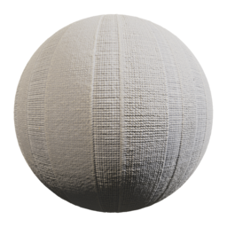</a> <b><a href="Carpet001">Carpet 001</a></b> by ambientCG · <a href="https://ambientcg.com/a/Carpet001">source</a> | <a href="Carpet002">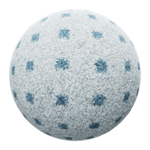</a> <b><a href="Carpet002">Carpet 002</a></b> by ambientCG · <a href="https://ambientcg.com/a/Carpet002">source</a> | <a href="Carpet003">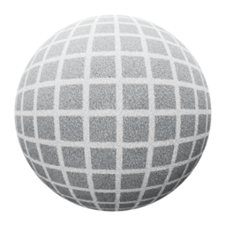</a> <b><a href="Carpet003">Carpet 003</a></b> by ambientCG · <a href="https://ambientcg.com/a/Carpet003">source</a> | <a href="Carpet004">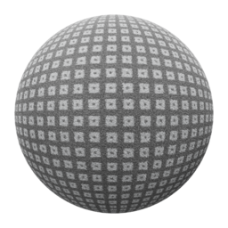</a> <b><a href="Carpet004">Carpet 004</a></b> by ambientCG · <a href="https://ambientcg.com/a/Carpet004">source</a> |
| <a href="Carpet005">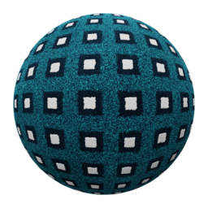</a> <b><a href="Carpet005">Carpet 005</a></b> by ambientCG · <a href="https://ambientcg.com/a/Carpet005">source</a> | <a href="Carpet006">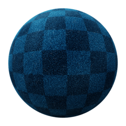</a> <b><a href="Carpet006">Carpet 006</a></b> by ambientCG · <a href="https://ambientcg.com/a/Carpet006">source</a> | <a href="Carpet007">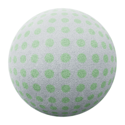</a> <b><a href="Carpet007">Carpet 007</a></b> by ambientCG · <a href="https://ambientcg.com/a/Carpet007">source</a> | <a href="Carpet008">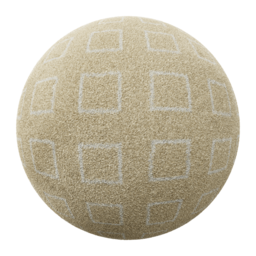</a> <b><a href="Carpet008">Carpet 008</a></b> by ambientCG · <a href="https://ambientcg.com/a/Carpet008">source</a> |
| <a href="Carpet009">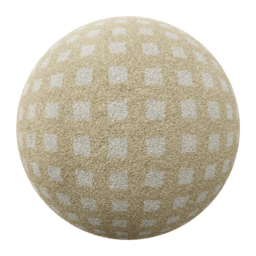</a> <b><a href="Carpet009">Carpet 009</a></b> by ambientCG · <a href="https://ambientcg.com/a/Carpet009">source</a> | <a href="Carpet010">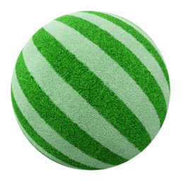</a> <b><a href="Carpet010">Carpet 010</a></b> by ambientCG · <a href="https://ambientcg.com/a/Carpet010">source</a> | <a href="Carpet011">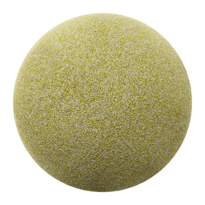</a> <b><a href="Carpet011">Carpet 011</a></b> by ambientCG · <a href="https://ambientcg.com/a/Carpet011">source</a> | <a href="Carpet012">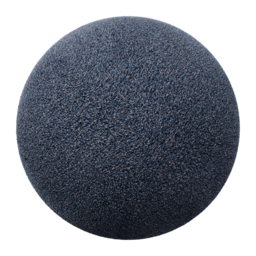</a> <b><a href="Carpet012">Carpet 012</a></b> by ambientCG · <a href="https://ambientcg.com/a/Carpet012">source</a> |
| <a href="Carpet013">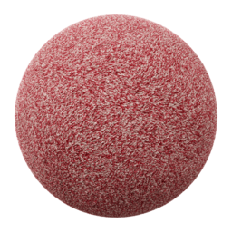</a> <b><a href="Carpet013">Carpet 013</a></b> by ambientCG · <a href="https://ambientcg.com/a/Carpet013">source</a> | <a href="Carpet014">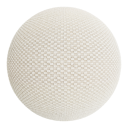</a> <b><a href="Carpet014">Carpet 014</a></b> by ambientCG · <a href="https://ambientcg.com/a/Carpet014">source</a> | <a href="Carpet015">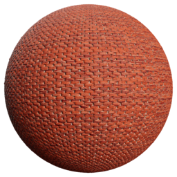</a> <b><a href="Carpet015">Carpet 015</a></b> by ambientCG · <a href="https://ambientcg.com/a/Carpet015">source</a> | <a href="Carpet016">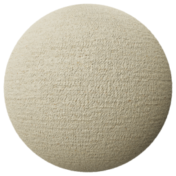</a> <b><a href="Carpet016">Carpet 016</a></b> by ambientCG · <a href="https://ambientcg.com/a/Carpet016">source</a> |

---

Kept up to date by this repository's own [update workflow](.github/workflows/update.yml), with code and plan from [cc0-mirror](https://github.com/zuujis-cc0/cc0-mirror). Something wrong? [Open an issue there](https://github.com/zuujis-cc0/cc0-mirror/issues/new) or use the [private report form](https://games.zuujis.com/report).
